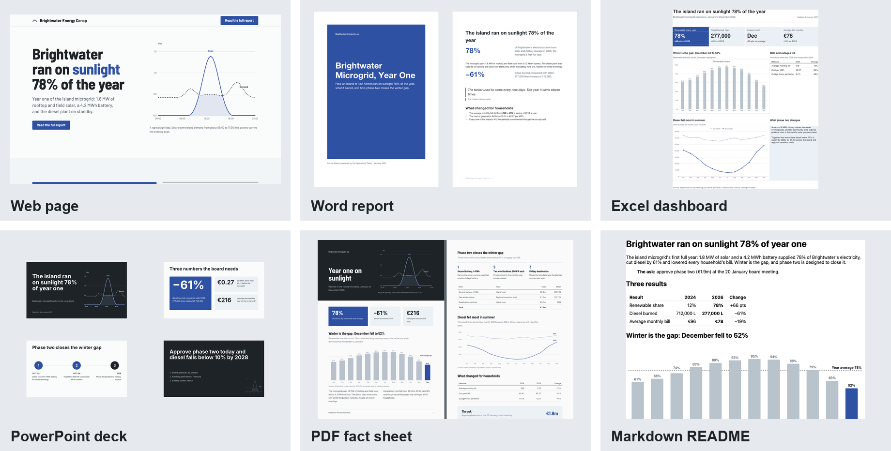
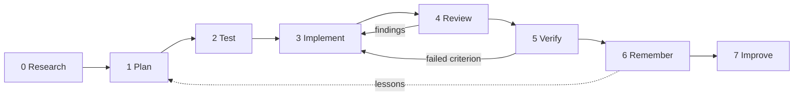
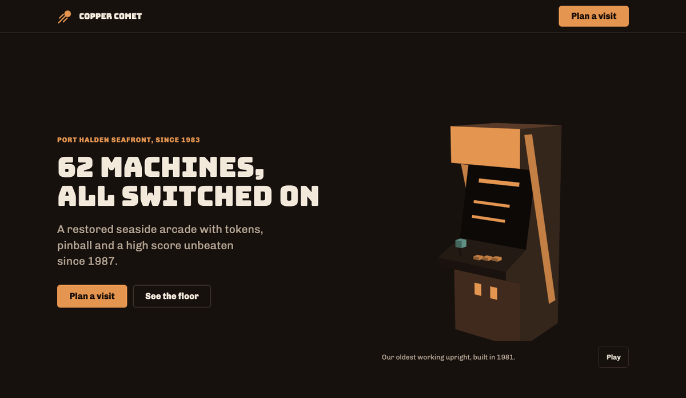
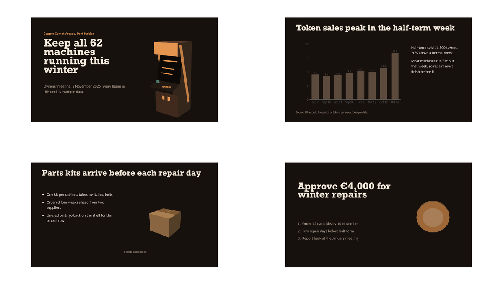
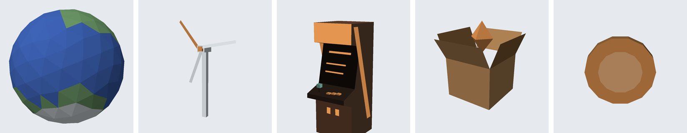
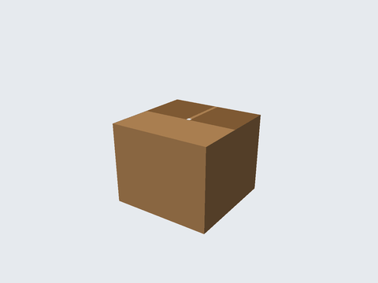

# Copilot Cowork skills that research, check and design your work

Eleven agent skills for Microsoft 365 Copilot Cowork:

- **Nine cycle skills** take every deliverable through one eight-step cycle, from checking current facts to saving what was learned.
- **visual-design-studio** makes the deliverables look art-directed: a web page, Word report, Excel dashboard, PowerPoint deck, PDF and Markdown page, all from one design system.
- **cowork-env-probe** reports what Cowork's sandbox can run.

> **Try it:** build the skill zips with `python3 tools/build.py`, upload them in Cowork, then ask *"Start a cycle: a board update on the microgrid's first year, with a deck and a fact sheet."*



<sub>The Brightwater test brief, built end to end by visual-design-studio from one DESIGN.md. Brightwater is a fictional island co-op.</sub>

## Every deliverable runs through one eight-step cycle



| Step | Skill | Writes to the ledger | Gate before the next step |
|:--|:--|:--|:--|
| 0 Research | `cycle-research` | Sourced, dated facts for anything time-sensitive | Facts checked, or the check waived on record |
| 1 Plan | `cycle-plan` | Goal, audience, scope, risks, approach | You approve the plan |
| 2 Test | `cycle-test` | Acceptance criteria, or failing tests for code | Criteria exist before any work starts |
| 3 Implement | `cycle-implement` | Build log and the deliverable | Built against the criteria |
| 4 Review | `cycle-review` | Findings by severity | No blocking finding left open |
| 5 Verify | `cycle-verify` | Pass or fail for each criterion, with evidence | Every criterion passes, and you confirm before anything is sent |
| 6 Remember | `cycle-remember` | Lessons saved to your memory files | None |
| 7 Improve | `cycle-improve` | Proposed changes to the skills or instructions | You approve each change |

**How the cycle runs:**

- `cycle-run` starts each task, creates the project folder and moves the work from step to step.
- **Gates are soft.** A skipped step gets a warning and an override note in the ledger; nothing is silently skipped.
- **Small tasks take the fast path:** all eight steps, compressed into one reply.

### What a project looks like in OneDrive
```text
Documents/
├── Projects/brightwater-microgrid/
│   ├── cycles/2026-10-12-board-update.md   the ledger: one section per step
│   ├── research/                           dated source snapshots
│   └── outputs/
│       ├── design/   DESIGN.md, brightwater.html, brightwater-report.docx, brightwater-dashboard.xlsx, …
│       └── deck/     deck.html, brightwater-board.pptx
└── Cowork/memory/
    └── lessons.md                          read by cycle-plan at the start of every cycle
```

Each ledger opens with a header that every skill reads and updates:
```yaml
project: brightwater-microgrid
phase: review
gates: {research: passed, plan: passed, test: passed, implement: passed, review: open, verify: open, remember: open, improve: open}
loops: {review: 1, verify: 0}
overrides: []
```

## visual-design-studio turns one brief into every format
The skill works like a design director:

1. **Read the brief:** decide what the deliverable is for and who it's for.
2. **Commit to a direction** taken from the subject itself.
3. **Write the design system once** in `DESIGN.md`: palette, type pairing, motif and motion plan.
4. **Build** for each medium, then check the result before you see it.

| You ask for | It builds | Command |
|:--|:--|:--|
| "Design a landing page" | One self-contained HTML page, in light and dark themes, that works on phones | `vds.py lint` |
| "Write it up as a report" | A Word document with a cover, contents, figures and a running footer | `vds.py docx` |
| "Make an Excel dashboard" | KPI tiles, live formulas, native charts and a one-page print layout | `vds.py xlsx` |
| "Turn it into a board deck" | Native, editable PowerPoint with charts, transitions, builds and speaker notes | `vds.py deck` |
| "A two-page fact sheet" | A print-ready PDF, with a check that no page is left near-empty | `vds.py pdf` |
| "A README for the project" | GitHub-ready Markdown with chart images and tables | `vds.py lint doc.md` |

**One data spec per chart:** `vds.py chart spec.json chart.svg` draws an SVG chart that follows the page's light and dark themes. The same spec gives a PNG for Word, the deck's native chart, and the dashboard's table.

### A different brief gets a different look




<sub>Copper Comet Arcade, a fictional seaside arcade. The skill avoided the usual neon look and took walnut cabinets, copper tokens and amber screens from the subject. The page and the deck share one DESIGN.md.</sub>

### Low-poly 3D, on the page and in the deck




- **On pages:** a small canvas renderer in plain JavaScript, with no libraries. Loops get a pause button, reduced-motion settings get a still frame, and animation stops when it's scrolled off screen.
- **In decks:** PowerPoint can't run that JavaScript, so `vds.py lowpoly` renders the same scenes as an MP4, a GIF and a still poster image, using the deck's own colours. The deck embeds the video with native timing: loops start with the slide, and one-off moments play on a click.

```bash
python3 scripts/vds.py lowpoly cabinet assets/cabinet --tokens deck.html --size 720x900
```

### Checked before you see it
| Check | What it catches |
|:--|:--|
| `vds.py lint` | Generic AI-design tells (purple gradients, Inter, three identical cards, em dashes), low contrast, missing alt text, missing reduced-motion handling |
| `vds.py deck-check` | Text overflow measured per font, off-palette colours, fonts that Office lacks, titles that drift between slides, motion rules, missing video posters |
| `vds.py pdf` | Underfilled or empty pages |
| `vds.py deck` | A broken package: XML, relationships and images are verified before it reports success |
| `vds.py render` | Page images of Office files, and formula errors in workbooks, through LibreOffice |

## Install in Cowork in four steps
1. Run `python3 tools/build.py`. It checks every skill and writes one zip per skill to `dist/`. Add `--check` to check without building.
2. In Cowork, upload each zip as a custom skill.
3. Optionally, paste [the custom instructions](custom-instructions.md) into **Cowork → Customize → Preferences**. They keep the cycle enforced even when a skill doesn't trigger by itself.
4. Test each skill in a new conversation.

## Repository
| Path | What's there |
|:--|:--|
| [skills/](skills/) | One folder per skill: `SKILL.md`, plus `template/`, `scripts/`, `reference/` and `examples/` |
| [shared/reference/](shared/reference/) | The cycle contract, copied into every cycle skill by the build |
| [tools/build.py](tools/build.py) | Checks and packages the skills |
| [PLAN.md](PLAN.md) | Design decisions and the change log |
| [custom-instructions.md](custom-instructions.md) | The Cowork Preferences snippet |
| [docs/images/](docs/images/) | The images on this page |

<sub>Every image is a render of the skills' own test outputs. All example content (Brightwater, Copper Comet, Port Halden) is fictional.</sub>

## License
MIT. See [the license](LICENSE).
